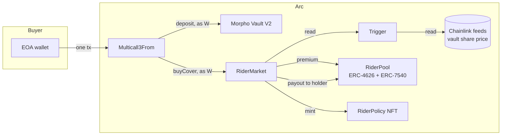

# Rider

**Parametric cover for USDC deposits on Arc.** You buy the cover in the same transaction as the deposit. If the vault loses value, EURC slips from the euro or cirBTC's reserves fall short, the contract reads the proof on-chain and pays the policy holder in USDC. Nobody files a claim and nobody approves it.

Live on Arc mainnet (chain 5042) · [App](https://rider-cover.vercel.app) · [Proof: every contract and transaction](PROOF.md) · [What we claim, and what we don't](CLAIMS.md)

---

## What it does

- **Protect a deposit in one transaction.** The depositor's wallet sends four calls through Arc's `Multicall3From`: approve, deposit into the vault, approve, buy cover. Arc's `CallFrom` precompile keeps the depositor as `msg.sender` for every call, so no router ever takes custody.
- **Pay on proof.** Each market watches one on-chain reading against a printed line. When the line is crossed and the loss is still there after a confirmation delay, the market pays `cover × loss since purchase` to whoever holds the policy NFT. Anyone can push the payout. The money only goes to the holder.
- **Refuse what it cannot stand behind.** The contracts refuse cover the pool cannot fully back, cover on a risk that is already firing or whose data is stale, and underwriter exits while a loss is visible. Every one of those refusals has been mined on mainnet ([PROOF.md](PROOF.md#refused-on-chain-mined-reverted-on-purpose)).

### Live markets

| Market | Reads | Fires at | Confirms after |
|---|---|---|---|
| Galaxy USDC vault | Morpho Vault V2 share price | 1% drawdown | 1 hour |
| Keyrock Prime USDC vault | Morpho Vault V2 share price | 1% drawdown | 1 hour |
| EURC peg to the euro | Chainlink EURC/USD ÷ EUR/USD | 2% below the euro | 6 hours |
| cirBTC reserve backing | Chainlink Proof-of-Reserve ÷ cirBTC supply | 1% short | 6 hours |

Both vaults are the Morpho Vault V2 vaults Circle's Earn Kit lists on Arc.

## What it uses Arc for

- **USDC is the gas.** A policy costs a fraction of a cent to buy, and a payout a fraction of a cent to push. That makes a 0.10 USDC policy worth writing and lets a keeper push every claim to its holder.
- **Sender-preserving batches.** The protected deposit is a single `Multicall3From` transaction; the vault and the market both see the depositor's address.
- **Deterministic sub-second finality.** Incident timestamps cannot be reorganised away, so the confirmation window is exact.
- **Circle's own risks, native to Arc.** Earn Kit's Morpho vaults, EURC against the euro, and cirBTC against the Proof-of-Reserve feed Chainlink publishes on Arc.

## How it works



**Lifecycle of a market:** `Active` → `openIncident` (anyone, once the reading crosses the line) → `Pending` → `resolveIncident` after the confirmation delay (still past the line: `Triggered`; recovered: back to `Active`) → claims (anyone pushes, holder is paid) → `settle` after the claim window → `Settled` → `rearm`.

**Contracts** ([`contracts/src`](contracts/src)):

- `RiderPool`: underwriting capital. ERC-4626 shares, asynchronous ERC-7540 exits with a 3-day cooldown, fully collateralised: `free = cash − unearned premium − locked cover`. Closes to deposits and exits while any trigger fires.
- `RiderMarket`: one per risk. Prices cover on a utilisation curve, books it in `CoverBook` (expiry buckets on a bitmap, so unearned premium and live cover are exact without looping over policies), runs the incident lifecycle and pays claims.
- `VaultDrawdownTrigger`, `PegTrigger`, `ReserveTrigger`: turn a reading into a loss ratio. A reading that cannot be trusted stops both sales and incidents.
- `RiderPolicy`: one ERC-721 per policy with fully on-chain SVG art. The token is the claim.
- `RiderFactory`: deploys markets and wires them in. A market added after underwriters have joined waits a 4-day notice before it can sell.
- `CanaryVault`: a vault Rider breaks on purpose, used only by the live drill ([MOCKS.md](MOCKS.md)).

## Verify it in five minutes

1. **Run the claims path yourself.** Open the [live drill](https://rider-cover.vercel.app/drill) and press *Run the live drill*. A relayer buys cover on the canary, breaks the canary by 20%, opens the incident, confirms it after 30 seconds and pays the holder. Every step links to the explorer. No wallet needed.
2. **One-transaction protected deposit:** the first row of [PROOF.md › Real cover](PROOF.md#real-cover-on-the-live-markets). Open it and look at the token transfers: USDC into Galaxy's vault and the premium into the pool, from the same sender, in one transaction.
3. **Refusals:** [PROOF.md › Refused on-chain](PROOF.md#refused-on-chain-mined-reverted-on-purpose) lists eight reverted mainnet transactions with the custom error each one hit.
4. **Source:** every contract is verified on Sourcify; links are in [PROOF.md › Contracts](PROOF.md#contracts).
5. **Tests against live Arc state:** `arc-forge test --match-path "test/fork/*" --fork-url https://rpc.mainnet.arc.io` (see below).

## Repository

| Path | What |
|---|---|
| [`contracts/`](contracts) | Foundry project: contracts, tests, deploy script, mainnet deployment |
| [`packages/sdk`](packages/sdk) | TypeScript SDK (viem): read markets, quote, build protected-deposit batches, plan drills |
| [`packages/mcp`](packages/mcp) | MCP server so agents can quote, buy and claim cover under a spending budget |
| [`packages/keeper`](packages/keeper) | Permissionless keeper: opens and confirms incidents, pushes claims, settles and rearms |
| [`packages/ops`](packages/ops) | Seeding, proof run and drill scripts; they write [`proof/arc-mainnet.json`](proof/arc-mainnet.json) |
| [`apps/web`](apps/web) | Next.js app: landing, markets, protect, underwrite, policies, live drill, proof |

## Run it

Requires Node 20+, pnpm 9 and Foundry.

```sh
git clone --recurse-submodules https://github.com/RaYYeR220/rider && cd rider
pnpm install
pnpm --filter @rider/sdk build

# contracts
cd contracts && forge test && cd ..

# web app (reads Arc mainnet; the drill is read-only without a relayer key)
pnpm --filter @rider/web dev

# keeper, dry run without a key
pnpm --filter @rider/keeper once

# MCP server for an agent (unsigned mode without RIDER_AGENT_KEY)
npx tsx packages/mcp/src/index.ts
```

Fork tests need [Arc Foundry](https://github.com/circlefin/arc-foundry): Arc's USDC lives behind protocol precompiles that stock Foundry does not emulate.

```sh
cd contracts
arc-forge test --match-path "test/fork/*" --fork-url https://rpc.mainnet.arc.io -vv
```

## Tests

| Suite | Count |
|---|---|
| Market: buying, refusals, incidents, claims, premium vesting, audit regressions | 39 |
| Pool: async redemptions, freezing, operators, fencing, audit regressions | 17 |
| Triggers: vault drawdown, peg cross-rate, reserve backing, stale and broken feeds | 12 |
| Invariant handler checks, including a negative control | 2 |
| Solvency invariants, 128 runs × 64 calls | 5 |
| Fork tests against live Arc mainnet state | 3 |
| MCP budget (vitest) | 7 |

Before deployment an independent adversarial review found two high- and five medium-severity issues (a cooldown-griefing path, an owner path to a fake market, underwriters exiting ahead of an unopened incident, peg and reserve payouts measured from the peg instead of the purchase, an unclaimable total loss, a zero Proof-of-Reserve answer read as a loss, and caller-chosen sampling). All but the last were fixed with regression tests (`test_audit_*`, `test_*SincePurchase`, `test_vault_totalLossIsClaimable`); the last is mitigated and listed in [CLAIMS.md](CLAIMS.md#not-claimed).

## Configuration

| Variable | Used by | Meaning |
|---|---|---|
| `ARC_RPC_URL` / `RPC_URL` | web, keeper, mcp, ops | Arc RPC; defaults to `https://rpc.mainnet.arc.io` |
| `RELAYER_KEY` | web | Drill relayer key. Without it the drill is read-only |
| `DRILL_HOLDER` | web | Address that holds drill policies and receives drill payouts |
| `DRILL_DAILY_ROUNDS`, `DRILL_MIN_BALANCE` | web | Drill rate limit and relayer balance floor |
| `KEEPER_KEY` | keeper | Optional; without it the keeper only reports |
| `RIDER_AGENT_KEY` | mcp | Optional; without it the server returns unsigned calls |
| `RIDER_MAX_PREMIUM_USDC`, `RIDER_DAILY_PREMIUM_USDC`, `RIDER_MAX_COVERAGE_USDC` | mcp | Agent spending limits. If any is missing the server signs nothing |
| `DEPLOYER_KEY`, `RELAYER_KEY`, `HOLDER_KEY`, `NETWORK` | ops | Keys and target for the seeding, proof and drill scripts |

## Honest limits

Rider is experimental software, not an insurance contract. No live market has fired yet; the paid claim on mainnet is on the canary vault. One key owns the factory and pools during the grant period. Pool capital is small. The full list is in [CLAIMS.md › Not claimed](CLAIMS.md#not-claimed) and [MOCKS.md](MOCKS.md).

## License

MIT
